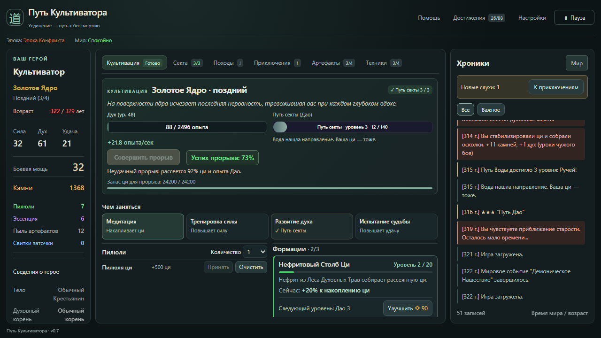

# Путь Культиватора

Браузерная idle-игра в мире сянься: накапливайте ци, совершайте прорывы, вступайте в секты, отправляйтесь в походы и начинайте новые жизни с накопленной кармой.

**[Играть в браузере](https://brohaj.github.io/cultivation_game/)**

## Как сделано и проверено

- Игра работает на обычных HTML, CSS и JavaScript без сборки; входная страница — `index.html`.
- [CLAUDE.md](CLAUDE.md) описывает структуру проекта, порядок скриптов, состояние игры и правила изменения механик.
- `npm test` проверяет игровую логику, регрессии и работу сохранений.
- `npm run test:browser` проверяет действия в интерфейсе и перезагрузку в Chromium через Playwright.
- `npm run balance:simulate` моделирует четыре жизни; отдельные симуляторы сравнивают экономику учеников и ценность походов.
- Вручную на текущем коде проверены экран духовного корня, начало первой жизни и обучающее окно; главный экран просмотрен на 1280 × 720. Долгое прохождение всех сект и бессмертного этапа этим не подтверждается.

Для локального запуска скачайте проект и откройте `index.html` в браузере. Прогресс хранится в браузере; экспорт и импорт доступны в настройках. Для тестов выполните `npm ci`, затем `npm test`. Браузерным тестам нужен Chromium Playwright (`npx playwright install chromium`).

История изменений — в [CHANGELOG.md](CHANGELOG.md), актуальные механики — в [docs/prototype_report.md](docs/prototype_report.md).
